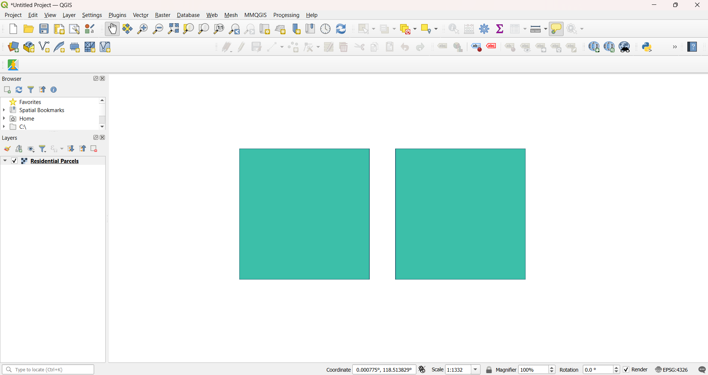
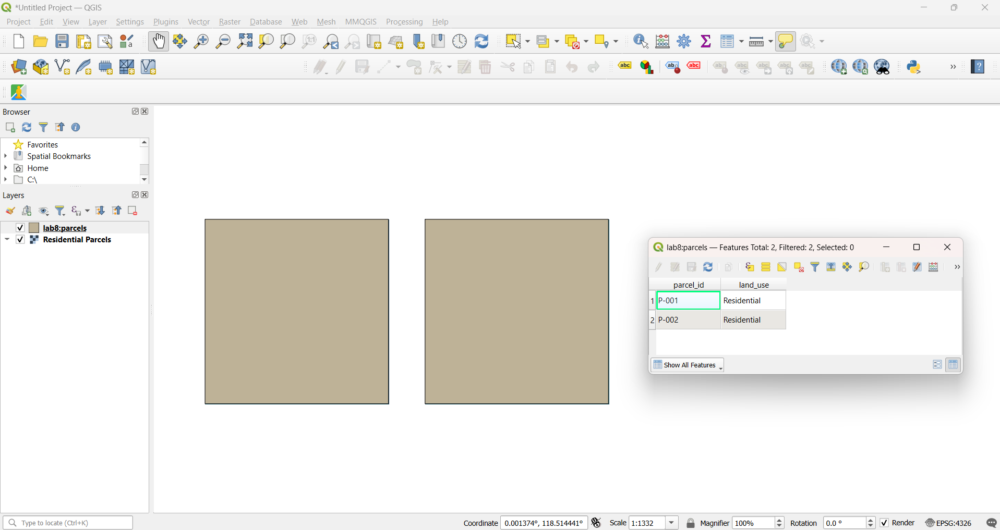
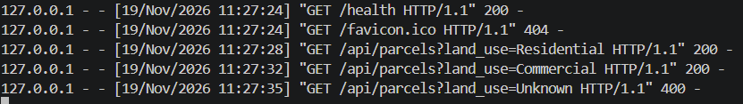

# GmE 205: Laboratory Exercise 8
**Reproducible Geoprocessing, Flask Services, and QGIS WMS/WFS Clients**
## Overview
*This laboratory exercise focuses on automating reproducible geoprocessing workflows using Python and PostGIS, organizing the process through a reusable ParcelPipeline class, and serving GeoJSON results through a local Flask API. It also introduces the use of QGIS as a client for accessing map and vector data through WMS and WFS services.*

## Environment

| Item | Value |
|---|---|
| Database | `gme205_lab6` (Lab 6 database, `lab6` schema) |
| PostgreSQL | 18.6 |
| PostGIS | 3.6 |
| Python | 3.14.7 |
| Packages | see `requirements.txt` (psycopg 3, python-dotenv, Flask, matplotlib) |

## Prerequisites

- **PostgreSQL + PostGIS** – spatial database
- **pgAdmin 4** – checks the database through the Query Tool
- **Python 3** – runs the pipeline and Flask service in `src/`
- **psycopg 3** – connects Python to PostgreSQL/PostGIS
- **python-dotenv** – loads database settings from `.env`
- **Flask** – serves the local GeoJSON, WMS, and WFS endpoints
- **matplotlib** – used by the given `map_renderer.py` to draw the WMS PNG map
- **QGIS** – client that loads the WMS and WFS layers
- **Web browser** – checks the Flask endpoints
- **VS Code** – edits Python, Markdown, and configuration files
- **Git / GitHub** – version control and submission

## Setup

1. Create and activate a virtual environment:
   ```cmd
   py -m venv .venv
   .venv\Scripts\activate
   pip install -r requirements.txt
   ```
2. Copy `.env.example` to `.env` and fill in your own database password.
3. Make sure `lab6.parcels` contains P-001 to P-004 (Lab 7 seed SQL).
4. Run the pipeline from the project root:
   ```cmd
   python src/run_lab8.py
   ```
5. Start the Flask service (leave this terminal running):
   ```cmd
   python src/app.py
   ```
   The service runs at `http://127.0.0.1:5000/`.

## Structure

- `src/database.py` – connection and parameterized query (reused from Lab 7)
- `src/spatial.py` – `Parcel` domain object (reused from Lab 7)
- `src/exchange.py` – FeatureCollection builder and validation (reused from Lab 7)
- `src/pipeline.py` – `ParcelPipeline` that coordinates the steps
- `src/run_lab8.py` – runs the pipeline twice, compares, and saves the GeoJSON
- `src/app.py` – Flask routes (`/health`, `/api/parcels`, `/wms`, `/wfs`)
- `src/map_renderer.py` – given helper, not modified
- `src/ogc_services.py` – given helper, not modified
- `output/residential_parcels.geojson` – saved pipeline output
- `evidence/` – screenshots for submission

## Evidence

**A. Console output of `python src/run_lab8.py`** (connection, feature count, equality, output path)


**B. WMS parcels map in QGIS** (WMS/WMTS connection to `http://127.0.0.1:5000/wms`)



**C. WFS parcels vector layer and attribute table in QGIS** (WFS connection to `http://127.0.0.1:5000/wfs`)



**D. Flask terminal showing requests** (`/health` 200, Residential 200, Commercial 200, Unknown 400)



The saved GeoJSON is in [`output/residential_parcels.geojson`](output/residential_parcels.geojson).

**Note on the GetMap test URL:** the sample BBOX (`118.5,0,118.505,0.005`) returned a blank PNG because the parcels lie further east (about 118.511–118.513° E). Using `BBOX=118.511,-0.0005,118.514,0.0025` showed both parcels. In QGIS, "Zoom to Layer" tool picks the correct extent automatically.

## Explain the Data Path

**1. What parts of the pipeline were reused from Laboratory 7–8 rather than rewritten?**
`database.py` (connection check and the parameterized query with `ST_Transform` and `ST_AsGeoJSON`), `spatial.py` (`Parcel.from_row()` and `to_feature()`), and `exchange.py` (FeatureCollection builder and validation) were copied unchanged from Lab 7, together with the same `lab6.parcels` table. Only `pipeline.py`, `run_lab8.py`, and `app.py` are new.

**2. Why is ParcelPipeline a useful coordinating object? What should it NOT do?**
The `ParcelPipeline` organizes the existing steps and runs them in the correct order using the land_use input. It should not handle database settings, SQL queries, Flask routes, file paths, or GeoJSON creation.

**3. Why must we specify stable query ordering when comparing outputs?**
Without `ORDER BY`, PostgreSQL may return records in different orders each time. This can make two outputs appear different even if the data is the same. Using `ORDER BY parcel_id` keeps the records in a consistent order.

**4. What is the difference between a saved .geojson file and the Flask endpoint?**
A `.geojson` file is a saved copy of the data that can be shared or opened offline. It does not automatically update when the database changes. On the other hand, the Flask endpoint retrieves updated data from the database whenever someone makes a request, accepts a parameter (`land_use`), and only works while the Flask server is running.

**5. How do the temporary prints and HTTP responses help locate a failed boundary?**
The printed messages help identify which step of the pipeline is working or failing, such as the database connection, feature count, or output comparison. HTTP status codes also help identify problems in the Flask service.  For example, `200` means success, `400` means invalid input, `503` means a database connection problem, and `500` means an internal error. In this exercise, the `ImportError` from an empty `ogc_services.py` and the blank GetMap image were identified as issues. 

**6. Compare WMS and WFS in QGIS: what can you inspect in the vector attribute table that you cannot inspect in the rendered WMS image?**
The WMS layer is only a PNG picture, so individual parcel attributes cannot be viewed or edited directly. WFS provides actual vector features, allowing users to open the attribute table and view information such as `parcel_id` and `land_use`. WFS features can also be selected, filtered, styled, and exported. he WMS 1.1.1 and WFS 1.0.0 services in this laboratory only support the basic requests needed for the exercise and are not OGC-certified servers.

## Author
Enoch Joshua V. Antonio  
MS Geomatics Engineering

## References

- OGC WMS 1.1.1: https://cite.ogc.org/te2/about/wms11/1.1.1/site/OGCTestData/wms/1.1.1/spec/wms1.1.1.html
- OGC WFS 1.0.0: https://cite.ogc.org/teamengine/about/wfs10/1.0.0/site/OGCTestData/wfs/1.0.0/specs/wfs/1.0.0/02-058.html
- QGIS OGC client: https://docs.qgis.org/3.44/en/docs/user_manual/working_with_ogc/ogc_client_support.html
- Flask Documentation: https://flask.palletsprojects.com/en/stable/quickstart/
- Psycopg 3: https://www.psycopg.org/psycopg3/docs/
- PostGIS: https://postgis.net/docs/
- RFC 7946: https://www.rfc-editor.org/rfc/rfc7946

Edited on GitHub web interface and VS Code