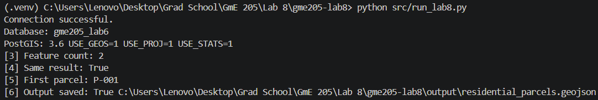

# GmE 205: Laboratory Exercise 8
**Reproducible Geoprocessing, Flask Services, and QGIS WMS/WFS Clients**
## Overview
*This laboratory exercise focuses on automating reproducible geoprocessing workflows using Python and PostGIS, organizing the process through a reusable ParcelPipeline class, and serving GeoJSON results through a local Flask API. It also introduces the use of QGIS as a client for accessing map and vector data through WMS and WFS services.*

## Environment

| Item | Value |
|---|---|
| Database | `gme205_lab6` (Lab 6 database, `lab6` schema) |
| PostgreSQL | 18.6 |
| PostGIS | 3.6 |
| Python | 3.14.7 |
| Packages | see `requirements.txt` (psycopg 3, python-dotenv, Flask, matplotlib) |

## Prerequisites

- **PostgreSQL + PostGIS** – spatial database
- **pgAdmin 4** – checks the database through the Query Tool
- **Python 3** – runs the pipeline and Flask service in `src/`
- **psycopg 3** – connects Python to PostgreSQL/PostGIS
- **python-dotenv** – loads database settings from `.env`
- **Flask** – serves the local GeoJSON, WMS, and WFS endpoints
- **matplotlib** – used by the given `map_renderer.py` to draw the WMS PNG map
- **QGIS** – client that loads the WMS and WFS layers
- **Web browser** – checks the Flask endpoints
- **VS Code** – edits Python, Markdown, and configuration files
- **Git / GitHub** – version control and submission

## Setup

1. Create and activate a virtual environment:
   ```cmd
   py -m venv .venv
   .venv\Scripts\activate
   pip install -r requirements.txt
   ```
2. Copy `.env.example` to `.env` and fill in your own database password.
3. Make sure `lab6.parcels` contains P-001 to P-004 (Lab 7 seed SQL).
4. Run the pipeline from the project root:
   ```cmd
   python src/run_lab8.py
   ```
5. Start the Flask service (leave this terminal running):
   ```cmd
   python src/app.py
   ```
   The service runs at `http://127.0.0.1:5000/`.

## Structure

- `src/database.py` – connection and parameterized query (reused from Lab 7)
- `src/spatial.py` – `Parcel` domain object (reused from Lab 7)
- `src/exchange.py` – FeatureCollection builder and validation (reused from Lab 7)
- `src/pipeline.py` – `ParcelPipeline` that coordinates the steps
- `src/run_lab8.py` – runs the pipeline twice, compares, and saves the GeoJSON
- `src/app.py` – Flask routes (`/health`, `/api/parcels`, `/wms`, `/wfs`)
- `src/map_renderer.py` – given helper, not modified
- `src/ogc_services.py` – given helper, not modified
- `output/residential_parcels.geojson` – saved pipeline output
- `evidence/` – screenshots for submission

## Evidence

**A. Console output of `python src/run_lab8.py`** (connection, feature count, equality, output path)



**B. WMS parcels map in QGIS** (WMS/WMTS connection to `http://127.0.0.1:5000/wms`)


**C. WFS parcels vector layer and attribute table in QGIS** (WFS connection to `http://127.0.0.1:5000/wfs`)


**D. Flask terminal showing requests** (`/health` 200, Residential 200, Commercial 200, Unknown 400)


The saved GeoJSON is in [`output/residential_parcels.geojson`](output/residential_parcels.geojson).

**Note on the GetMap test URL:** the sample BBOX (`118.5,0,118.505,0.005`) returned a blank PNG because the parcels lie further east (about 118.511–118.513° E). Using `BBOX=118.511,-0.0005,118.514,0.0025` showed both parcels. In QGIS, "Zoom to Layer" tool picks the correct extent automatically.

## Explain the Data Path

